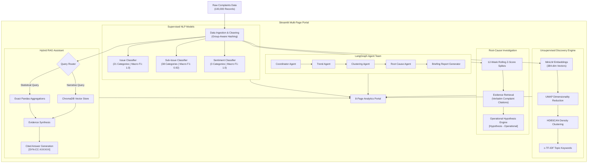

# Customer Complaint Root-Cause Classifier & Analytics Portal

An enterprise-grade, end-to-end Machine Learning, NLP, Clustering, Root-Cause Investigation, RAG, and Multi-Agent system for financial customer complaints.

Built with Python, Scikit-Learn, Google Gemini (gemini-2.0-flash / gemini-1.5-flash), Sentence-Transformers, ChromaDB, LangGraph, and Streamlit.

---

## 🏛️ System Architecture



---

## 📦 Project Modules

| Module | Title | Core Technologies | Key Output / Artifact |
|---|---|---|---|
| **Module 1** | **Exploratory Data Analysis** | Pandas, Seaborn, Matplotlib | [01_data_exploration.ipynb](file:///notebooks/01_data_exploration.ipynb), `reports/eda_report.txt` |
| **Module 2** | **Issue Classification** | Scikit-learn, TF-IDF, Logistic Regression | `models/issue_classifier.joblib` (21 Classes) |
| **Module 3** | **Sub-Issue Classification** | TF-IDF, Logistic Regression, Hierarchical Router | `models/sub_issue_classifier.joblib` (38 Classes) |
| **Module 4** | **Sentiment Analysis** | Balanced TF-IDF Classifier, Continuous Scoring | `models/sentiment_classifier.joblib` (-1.0 to +1.0 Score) |
| **Module 5** | **Semantic Embeddings & Clustering** | Sentence-Transformers, UMAP, HDBSCAN, c-TF-IDF | `reports/cluster_topics.csv`, 2D Visualizer |
| **Module 6** | **Root-Cause Investigation** | Rolling Z-score anomaly detection, Rule Engine | `reports/root_cause_reports/` (JSON & MD reports) |
| **Module 7** | **RAG-based AI Assistant** | ChromaDB, Hybrid Analytical/Semantic Retrieval | `vector_db/`, Cited RAG response generator |
| **Module 8** | **Trend Analytics** | Time Series Decomposition, Plotly | Interactive monthly trajectories & Sunburst charts |
| **Module 9** | **LangGraph Multi-Agent Team** | LangGraph StateGraph, Specialized Agents | `reports/agent_briefings/` executive reports |
| **Module 10** | **Streamlit Portal** | Streamlit, Plotly, Interactive Sandboxes | 8-page multi-page enterprise web application |

---

## 🚀 Quickstart & Installation

### 1. Environment Setup
```bash
# Clone or navigate to the repository
cd customer-complaint-root-cause-classifier1

# Activate virtual environment
.\venv\Scripts\Activate.ps1   # Windows PowerShell
# source venv/bin/activate    # Linux / macOS

# Install dependencies
pip install -r requirements.txt

# Configure your Gemini API key in .env:
# GEMINI_API_KEY=your_gemini_api_key_here
# LLM_MODEL=gemini-2.0-flash
```

### 2. Run Automated Test Suite
```bash
pytest -v tests/
```

### 3. Launch the Streamlit Portal
```bash
streamlit run app.py
```
Open your browser at `http://localhost:8501`.

---

## 🌐 Streamlit Portal Directory

The web portal includes 8 dedicated pages:
1. **Portfolio Dashboard** (`pages/1_Dashboard.py`): Executive KPIs, product distributions, top issue rankings, resolution velocity, and complaint browser.
2. **Complaint Classification** (`pages/2_Complaint_Classification.py`): Real-time interactive complaint sandbox and bulk CSV batch classification.
3. **Sentiment Analysis** (`pages/3_Sentiment_Analysis.py`): Continuous sentiment scoring, confidence breakdown, and synthetic template analysis.
4. **Complaint Clustering** (`pages/4_Complaint_Clustering.py`): Interactive 2D UMAP scatter plot, cluster topic drilldown, and c-TF-IDF keyword explorer.
5. **Root-Cause Analysis** (`pages/5_Root_Cause_Analysis.py`): Automated spike detector, hypothesis generator, and citation-backed investigation viewer.
6. **Trend Analytics** (`pages/6_Trend_Analytics.py`): 4-tab dashboard covering volume trajectories, channel efficiencies, and hierarchical product trees.
7. **AI Assistant** (`pages/7_AI_Assistant.py`): RAG chat interface with verifiable `[SYN-CC-XXXXXX]` complaint citations and hybrid routing.
8. **Model Evaluation** (`pages/8_Model_Evaluation.py`): Precision/Recall/F1 benchmark scorecards, confusion matrices, and data leakage safeguards.

---

## 🔬 Methodological Highlights & Transparency

> [!NOTE]
> **Operational Hypotheses vs. Ground Truth:**
> Operational root causes in this project are derived via statistical pattern detection and synthesized domain heuristics. All output explanations are strictly tagged as `[Hypothesis - Operational]` with verbatim complaint citations to support human root-cause investigators.

> [!IMPORTANT]
> **Data Leakage Safeguards:**
> Due to 28,799 exact duplicate narratives in the dataset, standard random train-test splitting introduces severe optimistic bias. All supervised models are trained and evaluated using `GroupShuffleSplit` on MD5 narrative hashes, guaranteeing zero narrative leakage between train and test splits.
